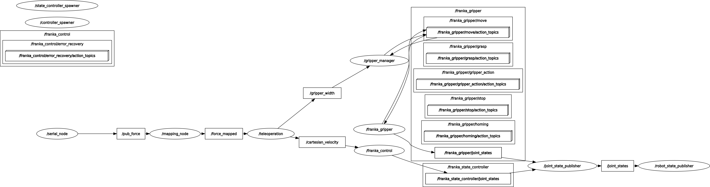

# Human-Robot Interaction Lab: Franka Emika Panda and NAO

Team lab course, 2025. Experiments on a real Franka Emika Panda arm (ROS 1, `franka_ros`) and a NAO humanoid.

## Franka Emika Panda

- **Kinematics**: forward kinematics of the Panda from its modified Denavit-Hartenberg parameters.
- **Trajectories**: joint-space trajectories by linear interpolation, and Cartesian straight-line trajectories
  solved point by point with Levenberg-Marquardt inverse kinematics (Robotics Toolbox for Python), each solution
  warm-started from the previous one; streamed to the joint trajectory controller.
- **Cartesian impedance control**: a command node moves the equilibrium pose of the Cartesian impedance
  controller at 100 Hz along a commanded direction, so the arm stays compliant while it moves.
- **Force-triggered motion**: a monitor node watches the estimated external joint torques. When a joint exceeds
  its threshold (someone pushes the arm), the end effector's motion direction switches to the direction of the
  measured external force, i.e. the robot moves where it is pushed.
- **Haptic teleoperation**: a gamepad commands Cartesian linear and angular velocity and gripper width. A force
  sensor (FSR) on the gripper is mapped to 0–1, used as a gripper force limit and fed back as gamepad rumble.

## NAO

- Dialog (QiChat) for a campus-guide scenario: greets visitors, lists the university's chairs, asks for the
  destination and the mode of transport, confirms, and gives directions.

## Code

The code is not published: it is written into the course's exercise templates, which belong to the course.
The ROS node graph from the teleoperation setup is below.

