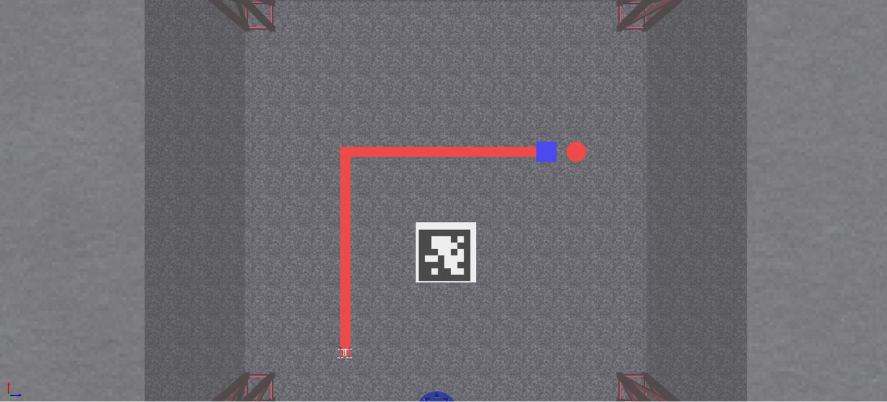
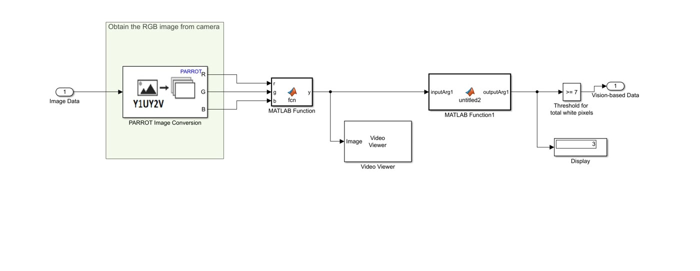
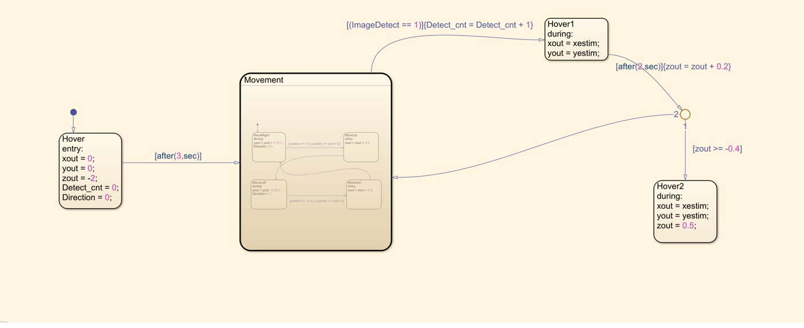
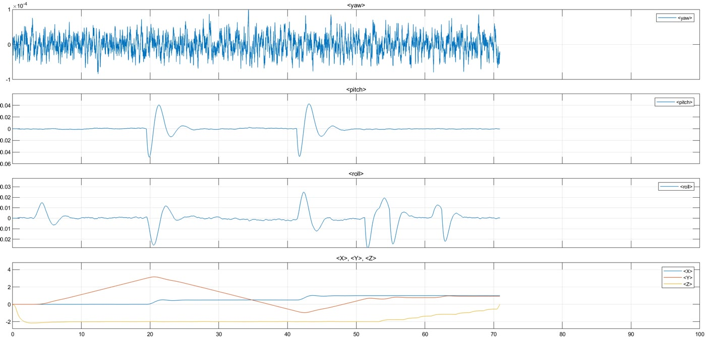
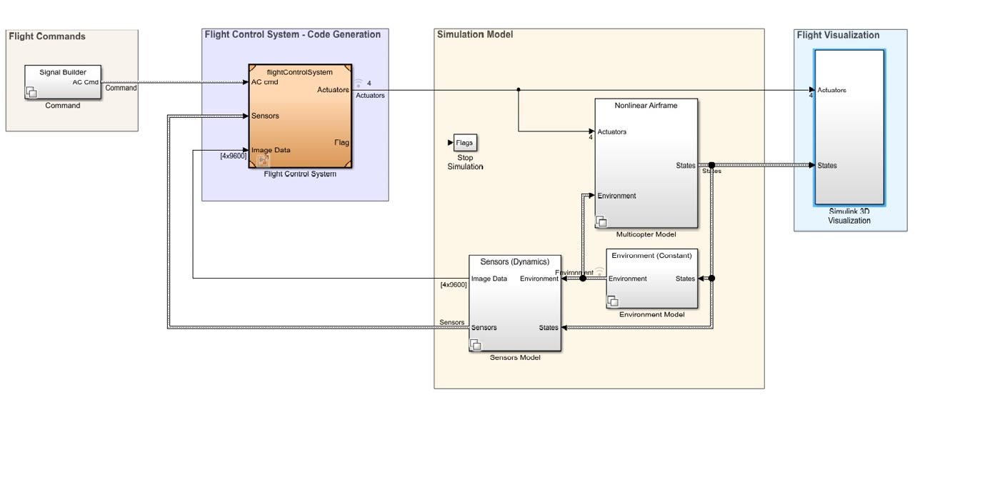

# Fiducial-Marker UAV Landing (Matrix Barcode Detection and Tracking)

B.Tech project, Amrita Vishwa Vidyapeetham (Electrical and Electronics Engineering), 2020–2021.
Team: Velayudhan A, Nandakishore R Nair, Neeraj S, Vishnu S. Mentor: Vivek A.

A quadrotor finds a matrix-barcode (AprilTag-style) landing pad with its downward camera and lands on it
autonomously, without an operator. Built in MATLAB/Simulink on top of MathWorks' Parrot minidrone flight-control
template, with our own image processing and mission logic.

## How it works

1. **Detection**: each downward camera frame is converted from YUV to RGB, thresholded and passed to MATLAB
   functions that flag whether the marker is in view.

   

2. **Mission logic (Stateflow)**:
   - take off and hover at 2 m;
   - search the area in a back-and-forth pattern until the marker is detected;
   - on detection, hold the current estimated position above the marker;
   - descend in 0.2 m steps, re-checking the detection after each step and resuming the search if it is lost;
   - below 0.4 m, commit to touchdown over the marker.

   

3. **Flight control and simulation**: position commands from the state machine go to the template's flight
   controller and nonlinear quadrotor model; the result is checked in the Simulink 3D environment and on the
   state-estimate plots.

   

Top level of the Simulink model:

